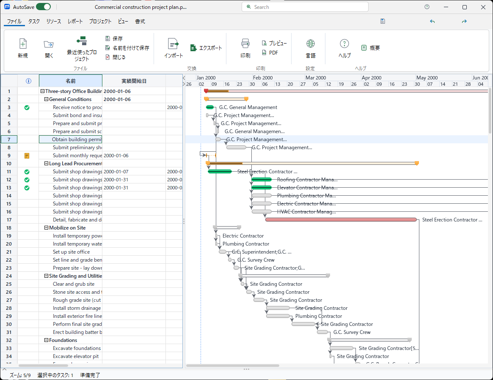

# microProject

This is the Windows-targeted ProjectLibre desktop fork; its release workflow
also builds Linux x64 and macOS Apple Silicon packages. Packaging availability
does not itself assert equal platform-specific behavior. microProject is a
desktop planning application with a task
hierarchy, schedules, dependencies, resources, progress, and a Gantt view. Its
product goal is complete compatibility with the standalone Microsoft Project
desktop application, including the current Microsoft 365 ribbon visual style
and desktop command behavior. **That compatibility goal is not yet achieved.**
MPO (`.mpo`) is the application's authoritative native format and default save
format. MPP (`.mpp`) remains a separate external interoperability target with
read and write acceptance gates; it is not the native project format. POD is a
frozen legacy import format. Desktop workflows and local automation/extensions
remain measurable acceptance gates. Project Server, PWA, Project Online, and Microsoft
Planner cloud authentication or synchronization are outside this standalone
product goal. The [compatibility goal](docs/msp-compatibility-goal.md) and
[roadmap](docs/msp-compatibility-roadmap.md) define the full scope.

microProject は、タスク階層、日程、依存関係、リソース、進捗をガント
チャートと一緒に管理するデスクトップ計画アプリです。製品目標は、
スタンドアロンの Microsoft Project デスクトップとの完全互換です。最新
Microsoft 365 版のリボン外観とデスクトップ操作を目標にしますが、互換性は
まだ完了していません。MPO（`.mpo`）を製品の正式なネイティブ形式かつ標準の
保存形式とします。MPP（`.mpp`）は別個の外部互換形式で、読み書きの検証対象です。
POD は wire 形式を変更しない旧形式の読込用です。デスクトップ業務フローとローカルの
自動化・拡張機能も個別に検証します。Project Server、PWA、Project Online、
Microsoft Planner のクラウド認証・同期はこの製品目標の対象外です。詳細は
互換性目標とロードマップを参照してください。

Quick links:

- [Stable releases and downloads](https://github.com/tetsuji16/ProjectLibre/releases/latest)
- [microProject documentation](https://o-server.main.jp/micro-project/)
- [Microsoft Project desktop compatibility roadmap](docs/msp-compatibility-roadmap.md) — goal, phased acceptance gates, and review of every currently open issue
- [Current ribbon command inventory](docs/MSP_STANDARD_COMMAND_INVENTORY.md)
- [Beta release plans](docs/beta-release-plan.md) (historical release planning)

| Gate | Scope | Status |
|---|---|---|
| M0 | Target and complete coverage inventory | Open — [#792](https://github.com/tetsuji16/ProjectLibre/issues/792) |
| M1 | Current Office-style ribbon visuals | Open — [#793](https://github.com/tetsuji16/ProjectLibre/issues/793) |
| M2 | Offline desktop workflow parity | Open — [#794](https://github.com/tetsuji16/ProjectLibre/issues/794) |
| M3 | MPP and other file interoperability | Open — [#796](https://github.com/tetsuji16/ProjectLibre/issues/796) |
| M4 | Local automation and extensions | Open — [#797](https://github.com/tetsuji16/ProjectLibre/issues/797) |
| M5 | Release compatibility acceptance | Open — [#795](https://github.com/tetsuji16/ProjectLibre/issues/795) |



The screenshot shows a commercial construction plan. The left pane organizes work as a WBS-style task hierarchy, while the Gantt pane shows the schedule, linked tasks, milestones, and parallel work streams on a shared timeline. Use the File menu to create, open, and save plans; the application also provides import, export, print, and PDF workflows from its desktop interface.

## Related repositories

The repositories with similar names are separate projects rather than runtime
modules of this application. `ProjectLibre` is this Java/Swing desktop fork;
`MicroProject` is the independent product direction and shared design space;
`oneProject` and `RustyProject` are separate experiments (including the Rust
implementation). They do not share project-file state or release artifacts.

## What This Fork Is For

- **Goal: complete standalone Microsoft Project desktop compatibility.** This
  is a work objective; compatibility is not complete. The target includes desktop
  workflows and project-file behavior, with MPP read and write as explicit
  acceptance gates. See the
  [compatibility roadmap](docs/msp-compatibility-roadmap.md) for scope, open
  coverage gaps, milestones, and issue review. Project Server, PWA, Project
  Online, and Microsoft Planner cloud services are outside the goal; local
  files, offline collaboration and local automation/extensions remain in scope.
  See [the compatibility goal](docs/msp-compatibility-goal.md) for verification
  rules.
- Keep microProject usable on a modern JDK and packaging toolchain
- Improve real-world planning workflows: task hierarchies, schedules, dependencies, resources, and progress in one desktop workspace
- Add collaboration-oriented features for teams sharing project files locally
- Make the Gantt and spreadsheet views smoother to use for large schedules

## Clean-room reconstruction status

microProject is being rebuilt through clean-room implementations based on
documented behavior, the OpenProj prototype, and independent fixtures. The
reconstruction is still in progress: some corrections have not yet been
completed, and legacy, compatibility, and newly reconstructed source code are
currently mixed in parts of the repository. Until this work is finished,
internal implementation boundaries may change and some areas should be
treated as transitional.

## Repository Layout

The repository uses `microProject` as the user-visible product name. The
Gradle root and module/JAR identifiers intentionally retain the historical
lower-case `microproject` spelling for build-path and artifact compatibility;
this is not a character-limit requirement. The full boundary and migration
policy is documented in [`docs/architecture/naming-policy.md`](docs/architecture/naming-policy.md).

The Gradle build currently contains eight production subprojects. The
authoritative list and source-directory mapping are maintained in
[`settings.gradle.kts`](settings.gradle.kts); keep this summary synchronized
when a module is added, removed, or renamed.

- `modules/microproject_core`: scheduling engine, data model, collaboration logic, and configuration
- `modules/microproject_application`: application workflows, file policies, and save/open coordination
- `modules/microproject_ui`: Swing UI, Gantt rendering, spreadsheet views, menus, and startup flow
- `modules/microproject_exchange`: file exchange, import/export, and format integration code
- `modules/microproject_reports`: report-related code and templates
- `modules/microproject_contrib`: shared third-party dependencies built into the app distribution
- `modules/microproject_bootstrap`: update/bootstrap entry point and packaged launch support
- `modules/microproject_ribbon`: reusable Swing ribbon API and extension SPI, independent of project-domain commands
- `packaging`: active packaging assets, licenses, and Windows release icons
- `samples`: sample project files for screenshots and manual verification
- `scripts`: launch helpers for local verification

The reports and import/export modules have an enforced independent boundary:
they may depend on the core model and their format/report libraries, but not on
the desktop UI or application workflow. Run `.\gradlew.bat verifyIndependentBoundaries`
to check this rule.

## Requirements

- Windows, Linux, or macOS with a full JDK that includes `jpackage` (platform packages must be built on their target OS)
- Java 25 or newer is required. Gradle compiles every Java source with
  `--release 25`; a newer installed JDK may be used as the toolchain runtime.
- Gradle Wrapper support files are included in this repository
- WiX Toolset on `PATH` for MSI packaging

If `JAVA_HOME` is not set, the Gradle release tasks fall back to `C:\Program Files\Java\jdk-25`.

## Build System Status

- `Gradle` is the supported build and release entrypoint for this repository
- `build.gradle.kts` drives module compilation, installable app layout generation, and Windows `jpackage` packaging
- The root build applies Java toolchains to all eight subprojects and pins
  `JavaCompile.options.release` to 25 for reproducible API compatibility
- CI uses Temurin JDK 25 and runs `verifyArchitectureBoundaries` before the
  repository build; see [`.github/workflows/build.yml`](.github/workflows/build.yml)
- `packaging` is the source of active packaging assets, icons, and license notices consumed by the Gradle tasks
- `packaging/windows/installer-resources` contains the English and Japanese WiX localization resources used by the Windows installers
- Keep `microproject_contrib` jars lean when updating dependencies so the packaged app size does not grow unnecessarily
- CI is aligned to the Gradle flow and validates the installable desktop layout on JDK 25

## Build The App

Compile every module and assemble the desktop application layout:

```powershell
.\gradlew.bat build
```

Create the runnable installed app layout:

```powershell
.\gradlew.bat stageAppDist
```

Key Gradle entrypoints:

- `.\gradlew.bat projects`: show the multi-project layout
- `.\gradlew.bat build`: compile the production modules and assemble per-module jars
- `.\gradlew.bat stageAppDist`: create the installed desktop app layout from `:microproject_ui:installDist`
- `.\gradlew.bat cleanLegacyPackagingArtifacts`: remove generated legacy packaging scratch output such as `isolated-build`
- `.\gradlew.bat packageWindowsAppImage`: build a Windows app-image with `jpackage`
- `.\gradlew.bat packageWindowsMsi`: build the Windows MSI
- `.\gradlew.bat packageWindowsExe`: build the Windows self-contained EXE
- `.\gradlew.bat publishReleaseToDocs`: publish the split EXE artifacts into local `docs/downloads` scratch space when needed

When you are manually verifying a UI fix, use the installed app layout created by `stageAppDist` / `installDist`, not an older `build/install` copy. See [docs/build-and-run.md](docs/build-and-run.md) for the exact runbook.

On Windows, the safest one-step launcher is `scripts\run_microproject_clean.bat`, and `scripts\run_projectlibre.bat` is a double-click entry point to the same flow.

The runnable application layout is generated under:

- `modules\microproject_ui\build\install\microproject_ui`

The root release work area is generated under:

- `build\releases\v<version>\`

Legacy packaging scratch output, if present, is disposable and should not be committed:

- `isolated-build\`

## Build The Windows Release

Build the Windows release artifacts and stage them locally:

```powershell
.\gradlew.bat packageWindowsMsi
```

The Windows MSI and EXE installers include English (`en-US`) and Japanese (`ja-JP`) WiX localization resources. Windows Installer selects the matching language for the package UI where supported; the application language remains controlled by the application's own locale settings.

The Gradle Windows release flow stages the packaging input under:

- `build\releases\v0.0.23\jpackage-input\`

The local MSI output is generated under:

- `build\releases\v0.0.23\msi\microProject-0.0.23.msi`

If you need the portable app-image ZIP or split EXE staging flow, use:

```powershell
.\gradlew.bat packageWindowsAppImage
.\gradlew.bat packageWindowsZip
.\gradlew.bat publishReleaseToDocs
```

Files under `docs/downloads/` are scratch space and must not be committed. Public binaries are GitHub Release assets.

## Automated Release and Documentation Deployment

The release workflow packages Windows MSI and portable ZIP artifacts and also builds Linux x64 and macOS Apple Silicon app-image ZIPs on their native GitHub Actions runners. The Windows GUI and packaged-launch gates remain required; release publication waits for every platform package job. A `release/beta-0.0.24-2` branch publishes `v0.0.24-beta.2` as a prerelease; beta releases do not replace stable `latest` assets or the unattended update feed.

The canonical documentation and download entry point is [o-server.main.jp/micro-project/](https://o-server.main.jp/micro-project/), built from `website/` by the o-server documentation workflow. GitHub Pages publishes redirect stubs from `pages-redirect/`; `docs/*.html` are legacy redirects.

If WiX was installed per-user rather than system-wide, keep its `bin` directory available on `PATH`. The Gradle MSI task also prepends the common per-user install path automatically:

```text
%LOCALAPPDATA%\Programs\WiX Toolset v7.0\bin
```

## Screenshot Procedure Used In This Repository

The README screenshot is intentionally captured so that only the application UI is visible.

- Launch the app by itself, not the whole desktop workspace
- Open `samples\sampledata.mpp`
- Arrange the main Gantt view at a readable zoom level
- Capture only the app window client area so title-bar paths, taskbar items, IDE windows, notifications, and personal information do not appear

## Quick Verification

- `.\gradlew.bat projects`: the multi-project Gradle layout resolves
- `.\gradlew.bat build`: all production modules compile successfully
- `.\gradlew.bat stageAppDist`: the runnable desktop layout is generated
- `.\gradlew.bat packageWindowsMsi`: the MSI is emitted successfully

## License

microProject keeps the original OpenProj/ProjectLibre license materials and third-party notices in `packaging/licenses`; product branding and distribution metadata are maintained separately.
